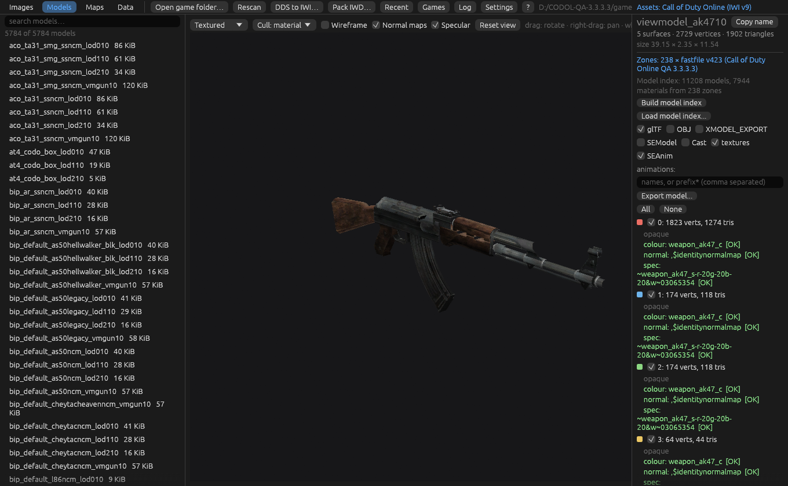

<div align="center">

# atlas

Open Call of Duty fastfiles, export models and maps to [Cast](https://github.com/dtzxporter/cast) for Blender, and edit zones.




**Models, animations and maps export to [Cast](https://github.com/dtzxporter/cast) and import into Blender.**

[What it does](#what-it-does) · [Tested games](#tested-games) · [Build](#build) · [Usage](#usage) · [Licence](#licence)

</div>

## What it does

- Browse images (IWI), models, animations and maps.
- Export models and animations to Cast for Blender, or to glTF, OBJ, SEModel and SEAnim.
- Dump string tables, localize strings and raw files to CSV and JSON.
- Unpack a zone to files, edit them, build it again (Call of Duty Online, Black Ops II).
- Convert a stock MW2 zone to Call of Duty Online.
- Check whether a zone reads cleanly (CoD4, MW2, MW3, Black Ops II).
- Pack IWDs, convert DDS to IWI.

> [!NOTE]
> Nothing atlas converts or writes has been tried in a game. The Black Ops II zones it writes are unsigned and the game may refuse them.

## Tested games

- Call of Duty Online, all builds
- Black Ops II
- Modern Warfare 2
- Call of Duty 4
- Modern Warfare 3 (the 64-bit build)
- Call of Duty HQ (`cod26`), containers only, no decoding

## Build

Windows: download the zip from [Releases](https://github.com/kypwny/atlas/releases) and run `atlas.exe`. To build it yourself:

Prerequisites: Rust 1.95 or newer, from [rustup.rs](https://rustup.rs). On Windows pick the MSVC toolchain, which needs the Visual Studio Build Tools (the C++ workload).

```bash
cargo build --release
```

Run `atlas` and drop a game folder on the window, or `atlas GAME_FOLDER`. A zone folder like `zone/all` works too.

Call of Duty Online 3.19 `.ifs` archives also need the helper next to the program:

```bash
rustup target add i686-pc-windows-msvc
cd tools/ifs_helper && cargo build --release --target i686-pc-windows-msvc
```

> [!WARNING]
> Call of Duty HQ needs `oo2core_8_win64.dll` from the game's own folder. atlas doesn't ship it.

## Usage

### Export to Cast and import into Blender

1. In Blender 3.6 or newer, install the Cast add-on from [dtzxporter/cast](https://github.com/dtzxporter/cast/releases): Edit > Preferences > Add-ons > Install from Disk, then enable **Cast Support**.
2. In atlas: open the game folder, Models tab, select the model, tick **Cast**. For animations, type their names (or `prefix*`) into **animations**. Export.
3. In Blender: File > Import > Cast (.cast) and pick `xmodel/<name>.cast`. You get the armature, meshes, materials and the animations as actions. Textures are PNGs in `images/`.

Command line:

```text
atlas --buildindex GAME_FOLDER index.tsv
atlas --exportmodel GAME_FOLDER viewmodel_ak47 OUT_DIR --index index.tsv --format cast --anim "viewmodel_ak47_*"
```

Black Ops II writes each animation as its own `xanim/<name>.cast`. Import the model first, then the animations with the armature selected:

```text
atlas --t6export ZONE.ff OUT_DIR --format cast --anims "pb_stand_*" --images --ipak IPAK_DIR
```

### Look at a map

Maps tab, pick a zone, View map. Drag rotates, right-drag pans, wheel zooms, Shift for fine. The Lights box shows the sun and the omni, spot and hero lights.

### Edit a raw file or string table

```text
atlas --unzone GAME_FOLDER ZONE.ff OUT_DIR
# edit the files in OUT_DIR; delete the ones you want removed
atlas --buildzone GAME_FOLDER OUT_DIR NEW.ff
```

Black Ops II: `--t6unzone ZONE.ff OUT_DIR` and `--t6buildzone OUT_DIR NEW.ff`. If another asset points into one you changed, it names both and stops.

### Dump the tables

```text
atlas --exportdata GAME_FOLDER OUT_DIR
```

### MW2 map to Call of Duty Online

```text
atlas --convertzone MW2.ff GAME_FOLDER OUT.ff
```

`--convertzone check MW2.ff` converts and runs the reader over the result.

### Check a zone

```text
atlas --zonewalk iw3|iw4|iw5|t6 FILE_OR_FOLDER
```

Prints `exact`, or the asset, offset and reason where it stopped.

`atlas --help` lists every command.

## Licence

GPL-3.0, see [LICENSE](LICENSE). Credits in [ATTRIBUTION.md](ATTRIBUTION.md). No game assets included. Not affiliated with Tencent, Activision or Treyarch.
